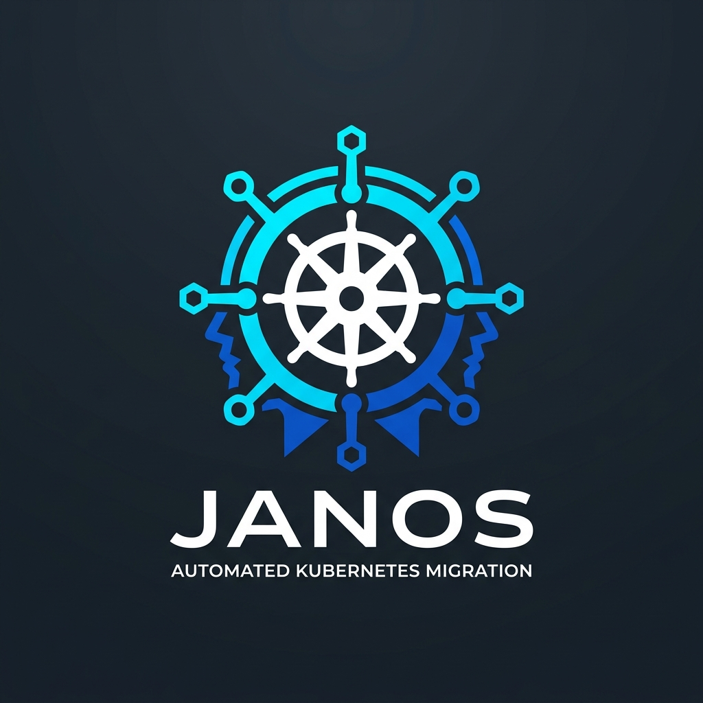

<div align="center">



# Janos

**Audit, preview, and migrate Kubernetes manifests**

*Audit deprecated Kubernetes APIs in manifests or live clusters, upgrade supported manifests, and generate Gateway API resources from Ingress definitions. Review the diff before applying a migration.*

[](https://github.com/pgold30/janos/actions/workflows/ci.yml)
[](https://nodejs.org/)
[](LICENSE.md)
[](CODE_OF_CONDUCT.md)

</div>

---

> **Why Janos?**
>
> In Roman mythology, **Janus** (Janos) is the god of transitions, doors, and passages — with two faces looking simultaneously into the past and into the future.
>
> When upgrading Kubernetes clusters, deprecated and removed APIs inevitably break deployments. Running manual find-and-replace across hundreds of GitOps repositories or Helm manifests is tedious, error-prone, and destroys your comments.
>
> **Janos bridges the gap**: it audits source manifests, previews supported migrations, and applies changes across a directory with target version gating. When a safe conversion needs information Janos cannot infer, it leaves the resource unchanged and reports the required manual work. It can also generate a starter Gateway API `HTTPRoute` from an Ingress. Its YAML parser retains comments on unchanged nodes, but structural transforms can rewrite formatting or comments within replaced sections. Always review the preview diff.

---

## Where Janos fits

| Task | Useful tool |
| :--- | :--- |
| Audit, preview, and edit source manifests in one local workflow | **Janos**: recursive edits, target version gating, CI checks, and manual-migration diagnostics |
| Find deprecated APIs in files and stored Helm releases | [Pluto](https://pluto.docs.fairwinds.com/) |
| Inspect original manifests stored by Helm or `kubectl apply` in a cluster | [Kube No Trouble](https://github.com/doitintl/kube-no-trouble) |
| Translate controller-specific Ingress behavior into Gateway API resources | [ingress2gateway](https://github.com/kubernetes-sigs/ingress2gateway) |
| Convert one Kubernetes object using the official conversion plugin | [kubectl convert](https://kubernetes.io/docs/reference/using-api/deprecation-guide/) |

Janos is most useful when a team owns GitOps manifests and wants a reviewable sequence: **audit → dry-run diff → migrate → CI check**. For cluster history or provider-specific Gateway behavior, use the specialist tools above alongside Janos.

---

## ⚡ Quick Start: How to Use

Install Janos from this repository, then run the commands below in the directory containing your manifests:

```sh
npm install --global github:pgold30/janos
janos --version
```

For a one-off run without a global install, use `npm exec --yes --package=github:pgold30/janos -- janos --audit -d ./k8s`. The `janos` package is not currently published on npm, so `npx janos` does not install this repository.

### 1. Audit for Deprecated APIs (Read-Only)
Find out what will break in your repository or running cluster without changing a single file:
```sh
# Audit all YAML manifests in a directory:
janos --audit -d ./k8s

# Audit an active Kubernetes cluster directly via kubectl:
janos --cluster --audit

# Focus only on APIs completely removed in your target version:
janos --audit -d ./k8s --target-version 1.25 --only-removed
```

Cluster mode queries a fixed set of workload and networking kinds through `kubectl`. The API server may return a newer served `apiVersion` than the one originally used to create a resource, so cluster audit cannot replace scanning the source manifests. It does not inspect every Kubernetes resource kind.

Example audit report output with severity tags:

| Kind | Name | Namespace | Current API | Target API | Removed In | Status | File |
| :--- | :--- | :--- | :--- | :--- | :---: | :---: | :--- |
| Ingress | `web-ingress` | `default` | `extensions/v1beta1` | **`networking.k8s.io/v1`** | **v1.22** | 🔴 REMOVED | `k8s/ingress.yaml` |
| CronJob | `cleanup` | `prod` | `batch/v1beta1` | **`batch/v1`** | **v1.25** | 🟡 DEPRECATED | `k8s/cron.yaml` |

### 2. Preview Changes with Colored Diff (`--diff`)
See the exact unified diff before modifying anything:
```sh
janos -d ./k8s --dry-run --diff
```

### 3. Migrate In-Place
Upgrade supported manifests after reviewing the diff. Comments on unchanged YAML nodes are retained; transformed sections may be reformatted:
```sh
# Option A: Automatic in-place migration across the entire directory:
janos -d ./k8s

# Option B: Interactive mode — review & confirm each file (y/n/d/a/q):
janos -d ./k8s -i
```

*In interactive mode (`-i`), Janos prompts for each changed file (`[y]es, [n]o, [d]iff, [a]ll, [q]uit`). Resources requiring manual migration are reported and left unchanged; `--check` exits nonzero for them.*

### 4. Gate to Your Target Cluster Version (`--target-version`)
Upgrading from 1.22 to 1.25? Don't prematurely apply 1.26 or 1.29 changes. Gate migrations strictly to your cluster's target version:
```sh
janos -d ./k8s --target-version 1.25 --dry-run --diff
```

### 5. Convert Ingress to Gateway API (`--ingress-to-gateway`)
Modernize legacy Ingresses into Gateway API `HTTPRoute` resources (with path matching, rewrites, and SSL redirect filters):
```sh
# Generate HTTPRoute alongside your Ingress:
janos --ingress-to-gateway -f ingress.yaml

# Generate HTTPRoute AND companion Gateway resource:
janos --ingress-to-gateway --generate-gateway -f ingress.yaml --out gateway.yaml
```

The generated file is separate from the source Ingress. The default name is `ingress.gateway.yaml`. Review `parentRefs`, Gateway class, TLS, backend ports, and annotation translations before applying it. Use `--dry-run` or `--check` to avoid writing output.

### 6. Track Provenance & Keep Git Blame Clean (`--annotate`, `--git-blame-ignore`)
Keep track of what changed without polluting your git history:
```sh
# Stamp upgraded resources with metadata annotations:
janos -d ./k8s --annotate

# Append inline comments showing the replaced API version:
janos -d ./k8s --annotate-inline

# Create a blame-ignore file while migrating:
janos -d ./k8s --git-blame-ignore
# After committing, add that commit's SHA to .git-blame-ignore-revs.
```

With `--annotate` (or `--stamp`), Janos embeds provenance metadata:
```yaml
metadata:
  annotations:
    janos.io/migrated-from: "batch/v1beta1"
    janos.io/migrated-at: "2026-09-16"
    janos.io/upgraded-by: janos
```
And with `--annotate-inline`:
```yaml
apiVersion: batch/v1 # [janos]: migrated from batch/v1beta1
kind: CronJob
```

---

## 🔧 Advanced Usage & Integrations

*(For GitOps pipelines, Helm charts, Unix streams, and automated CI/CD pull request checks)*

### 1. ⎈ Helm Chart & Template Support
Janos provides native support for Helm without breaking Go template syntax:
- **Render & Audit Charts**:
  ```sh
  janos --chart ./charts/my-app --audit
  janos --chart ./charts/my-app --values ./prod-values.yaml --audit --format markdown
  ```
- **Migrate Raw Helm Templates In-Place**:
  Updates literal `apiVersion` lines for simple rules inside `templates/*.yaml` while keeping `{{ ... }}` Go expressions untouched. Structural cases are reported for manual review. Render and validate the chart afterward:
  ```sh
  janos -d ./charts/my-app/templates
  ```

### 2. 🚰 Unix Piping & Stream Processing (`-`)
Pipe rendered output from `helm`, `kustomize`, or `cat` directly through Janos:
```sh
# Audit Helm template stream:
helm template my-release ./charts/my-app | janos - --audit --format markdown

# Diff Kustomize build stream:
kustomize build overlays/production | janos - --diff

# Stream and save upgraded manifests:
cat legacy-deploy.yaml | janos - > modern-deploy.yaml
```

### 3. 🤖 GitHub Actions CI
Automatically scan pull requests in CI and block deprecated APIs:
```yaml
name: Kubernetes Deprecation Gate

on: [pull_request]

jobs:
  audit:
    runs-on: ubuntu-latest
    steps:
      - uses: actions/checkout@v4

      - name: Audit Kubernetes Manifests
        uses: pgold30/janos@master
        with:
          path: './k8s'
          args: '--audit --format markdown'
          check: 'true'
          target-version: '1.25'
```
*Janos emits GitHub Actions warning annotations and writes markdown reports to the job summary. The action installs its Node dependency when it runs. `args` accepts whitespace-separated flags and values; paths with spaces belong in the dedicated `path`, `chart`, or `values` inputs.*

### 4. 🪝 Pre-commit Hook Integration
Block deprecated manifests from ever being committed to git. Add to `.pre-commit-config.yaml`:
```yaml
repos:
  - repo: https://github.com/pgold30/janos
    rev: master # pin to a commit SHA or release tag for production use
    hooks:
      - id: janos-audit     # Read-only verification before commit
      # - id: janos-migrate # Or auto-migrate in-place before commit
```

The hooks process every filename passed by pre-commit, including filenames containing spaces. The migration hook checks each file again after writing and fails if manual work remains.

### 5. 🌐 Cluster Filters & Exporting
```sh
# Filter live cluster audit to a single namespace:
janos --cluster --namespace staging --audit

# Specify a custom kubeconfig file:
janos --cluster --kubeconfig ~/.kube/staging-config --audit

# Save audit report directly to a file:
janos --audit -d ./k8s --format markdown --output-file audit-report.md
```

### 6. 🐳 Docker (`ghcr.io`)
For CI runners without Node.js:
```sh
# Audit manifests from container (mount local directory):
docker run --rm -v $(pwd)/k8s:/var/janos ghcr.io/pgold30/janos --audit -d /var/janos

# Audit running cluster from container (mount kubeconfig):
docker run --rm -v ~/.kube:/root/.kube:ro ghcr.io/pgold30/janos --cluster --audit
```

---

## 🛠️ CLI Options Reference

```text
Usage:
  janos [options] [path]
  <stream> | janos - [options]

Core Options:
  -f, --file <file>             Target single manifest file to convert ('-' for stdin)
  -d, --dir <dir>               Target directory to recursively scan and convert
  -i, --interactive             Interactive mode: confirm each file modification (y/n/d/a/q)
      --stdin                   Read manifests from standard input (pipe)
  -n, --dry-run                 Preview changes without modifying files
      --diff                    Show unified color diff of changes
  -c, --check                   CI mode: exit 1 if any files need migration, 0 if clean

Audit & Filter Options:
      --audit, --scan           Pluto-style read-only audit: scan and print summary table
      --target-version <ver>    Gate migrations up to a specific Kubernetes version (e.g. 1.25)
      --only-removed            Audit: only list APIs that are completely removed in target version
      --format <format>         Output format: table (default), markdown, json, or annotations
      --output-file <file>      Write audit report directly to a file

Cluster & Helm Options:
      --cluster, --live         Audit running Kubernetes cluster directly via kubectl
      --namespace <ns>          Namespace filter for live cluster audit (default: all namespaces)
      --kubeconfig <file>       Custom kubeconfig file path
      --chart, --helm <dir>     Scan or render Helm chart directory via 'helm template'
      --values <file>           Specify values YAML file for Helm chart rendering

Gateway API Options:
      --ingress-to-gateway      Translate Ingress manifests to Gateway API (HTTPRoute)
      --generate-gateway        Generate companion Gateway resource with --ingress-to-gateway
      --out <file>              Output file for generated Gateway resources (default: <source>.gateway.yaml)

Provenance & Git Options:
      --annotate, --stamp       Stamp upgraded manifests with janos.io/migrated-* metadata annotations
      --annotate-inline         Append inline comments to upgraded lines (e.g. # [janos]: migrated from ...)
      --git-blame-ignore        Create/update .git-blame-ignore-revs and configure git to preserve blame history

General & CI:
      --ignore <patterns>       Comma-separated glob ignore patterns (or use .janosignore)
      --annotations             Emit GitHub Actions workflow annotations (auto in CI)
  -q, --quiet                   Suppress non-essential output
  -v, --version                 Print version information
  -h, --help                    Print this help message
```

---

## 📋 Supported API Migrations (v1.16 – v1.32+)

| Resource Kind | Deprecated / Removed Versions | Target Version | Removed In | Transformation Details |
| :--- | :--- | :--- | :---: | :--- |
| **Deployment** | `extensions/v1beta1`, `apps/v1beta1`, `apps/v1beta2` | `apps/v1` | 1.16 | Generates required `spec.selector` if missing |
| **DaemonSet** | `extensions/v1beta1`, `apps/v1beta2` | `apps/v1` | 1.16 | Generates required `spec.selector` if missing |
| **StatefulSet** | `apps/v1beta1`, `apps/v1beta2` | `apps/v1` | 1.16 | Generates required `spec.selector` if missing |
| **ReplicaSet** | `extensions/v1beta1`, `apps/v1beta1`, `apps/v1beta2` | `apps/v1` | 1.16 | Generates required `spec.selector` if missing |
| **NetworkPolicy** | `extensions/v1beta1` | `networking.k8s.io/v1` | 1.16 | API version update |
| **Role / ClusterRole** | `rbac.authorization.k8s.io/v1alpha1`, `v1beta1` | `rbac.authorization.k8s.io/v1` | 1.17 / 1.22 | Full RBAC v1 migration |
| **RoleBinding / ClusterRoleBinding** | `rbac.authorization.k8s.io/v1alpha1`, `v1beta1` | `rbac.authorization.k8s.io/v1` | 1.17 / 1.22 | Full RBAC v1 migration |
| **Ingress** | `extensions/v1beta1`, `networking.k8s.io/v1beta1` | `networking.k8s.io/v1` | 1.22 | Migrates `spec.backend` to `defaultBackend`, converts `serviceName`/`servicePort` to `service.name`/`port`, adds `pathType: Prefix` (or convert to Gateway API with `--ingress-to-gateway`) |
| **IngressClass** | `networking.k8s.io/v1beta1` | `networking.k8s.io/v1` | 1.22 | API version update |
| **CustomResourceDefinition** | `apiextensions.k8s.io/v1beta1` | `apiextensions.k8s.io/v1` | 1.22 | Moves legacy fields into `spec.versions`; requires an existing structural schema |
| **ValidatingWebhookConfiguration** | `admissionregistration.k8s.io/v1beta1` | `admissionregistration.k8s.io/v1` | 1.22 | Preserves old defaults; requires explicit `sideEffects` and `admissionReviewVersions` |
| **MutatingWebhookConfiguration** | `admissionregistration.k8s.io/v1beta1` | `admissionregistration.k8s.io/v1` | 1.22 | Preserves old defaults; requires explicit `sideEffects` and `admissionReviewVersions` |
| **StorageClass / CSIDriver / CSINode** | `storage.k8s.io/v1beta1` | `storage.k8s.io/v1` | 1.22 | API version update |
| **VolumeAttachment** | `storage.k8s.io/v1beta1` | `storage.k8s.io/v1` | 1.22 | API version update |
| **APIService** | `apiregistration.k8s.io/v1beta1` | `apiregistration.k8s.io/v1` | 1.22 | API version update |
| **PriorityClass** | `scheduling.k8s.io/v1beta1` | `scheduling.k8s.io/v1` | 1.22 | API version update |
| **Lease** | `coordination.k8s.io/v1beta1` | `coordination.k8s.io/v1` | 1.22 | API version update |
| **CertificateSigningRequest** | `certificates.k8s.io/v1beta1` | `certificates.k8s.io/v1` | 1.22 | Requires an explicit signer, request, and valid usages |
| **TokenReview / SubjectAccessReview** | `authentication/authorization.k8s.io/v1beta1` | `authentication/authorization.k8s.io/v1` | 1.22 | Full v1 authorization review migration |
| **CronJob** | `batch/v1beta1` | `batch/v1` | 1.25 | Batch v1 migration |
| **PodDisruptionBudget** | `policy/v1beta1` | `policy/v1` | 1.25 | Policy v1 migration |
| **EndpointSlice** | `discovery.k8s.io/v1beta1` | `discovery.k8s.io/v1` | 1.25 | Discovery v1 migration |
| **Event** | `events.k8s.io/v1beta1` | `events.k8s.io/v1` | 1.25 | Events v1 migration |
| **RuntimeClass** | `node.k8s.io/v1beta1` | `node.k8s.io/v1` | 1.25 | Node v1 migration |
| **HorizontalPodAutoscaler** | `autoscaling/v2beta1`, `v2beta2` | `autoscaling/v2` | 1.25 / 1.26 | Converts supported metric sources and checks target values |
| **CSIStorageCapacity** | `storage.k8s.io/v1beta1` | `storage.k8s.io/v1` | 1.27 | Storage v1 migration |
| **FlowSchema / PriorityLevelConfig** | `flowcontrol.apiserver.k8s.io/v1beta1..3` | `flowcontrol.apiserver.k8s.io/v1` | 1.26–1.32 | Flow control v1 migration |
| **PodSecurityPolicy** | `extensions/v1beta1`, `policy/v1beta1` | Manual migration | 1.25 | Left unchanged; `--check` fails and points to Pod Security Admission |

The schema checks above cover known migration requirements; they do not replace validation against the target Kubernetes API server. Other rules in this table still only change `apiVersion` and may need structural work. In particular, review Event and EndpointSlice fields and empty PodDisruptionBudget selectors before applying. See [ROADMAP.md](ROADMAP.md) for the next validation work.

---

## 🧪 Development & Testing

Janos uses Node's native test runner (`node:test`) and the declared `yaml` dependency. Install dependencies first:

```sh
# Install locked dependencies and run the full test suite:
npm ci
npm test

# Run tests in watch mode:
node --test --watch
```

---

## 👤 Maintainer

Created and maintained with ❤️ by **Pablo Loschi**:
- **GitHub**: [@pgold30](https://github.com/pgold30)
- **Email**: [loschi.pablo@gmail.com](mailto:loschi.pablo@gmail.com)
- **Medium**: [@pgold30](https://medium.com/@pgold30)

## 📄 License

Apache License 2.0. See [LICENSE.md](LICENSE.md) for details.
